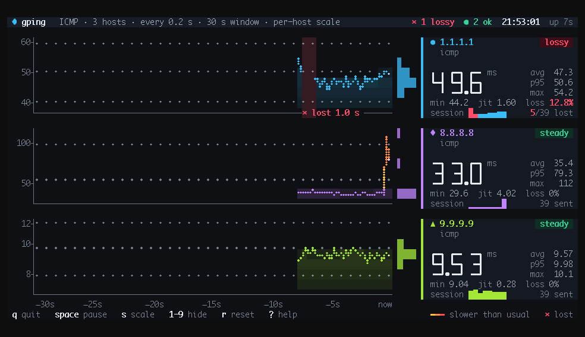
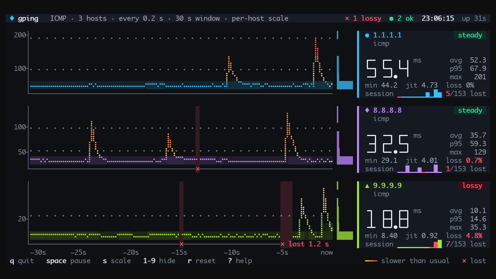

# gping 🚀

[](https://crates.io/crates/gping)
[](https://github.com/orf/gping/actions)

Ping, but with a graph.



Comes with the following super-powers:
* Graph the ping time for multiple hosts, each in a lane of its own
* Graph the _execution time_ for commands via the `--cmd` flag
* See at a glance when a host is slower than it usually is: its line warms through amber, orange and red
* Lost pings are hard to miss: a red curtain through the lane, a ✕ on the rail beneath it, and a caption on longer outages
* A live readout for every host, with stats for the window and the whole session
* Pause, rescale, hide hosts, and keep a session report in your scrollback when you quit
* Custom colours, 24-bit colour with fallbacks for 256- and 16-colour terminals
* Windows, Mac and Linux support

Table of Contents
=================

   * [Install :cd:](#install-cd)
   * [Usage :saxophone:](#usage-saxophone)

# Install :cd:

This is a fork of [gping](https://github.com/orf/gping). The packages in Homebrew, the Linux distributions, Scoop,
Chocolatey, WinGet, crates.io and Docker are all the original, without the changes here. To get this version:

* Download a build from the [releases page](../../releases)
* Or build it from a checkout of this repository (this requires `rustc` version 1.88.0 or greater):
  `cargo install --locked --path gping`

# Usage :saxophone:

Just run `gping [host]`. `host` can be a command like `curl google.com` if the `--cmd` flag is used. You can also use
shorthands like `aws:eu-west-1`, `aws:ca-central-1` or `gcp:me-central2` to ping specific cloud regions.

## Reading the screen



* Each host gets a lane. Its line scrolls from right to left, the newest reply at the right edge, on a scale
  fitted to that host (press `s` to put every lane on one scale).
* The line keeps its host's colour while the host answers as fast as it usually does, and turns amber, orange and
  then red where it's slower than its usual: the median of its last ten minutes, so a 7 ms resolver and a 180 ms
  path across an ocean are each judged against themselves.
* A lost ping breaks the line, drops a red curtain through the lane and puts a ✕ on the rail under it. Outages of a
  second or more are captioned with how long they lasted.
* The card on the right shows the latest latency in big digits, the host's status (steady, slow, lossy, down or
  waiting), its stats over the window, and a sparkline of the whole session. The bars beside it show where its
  latency usually sits.
* The title bar sums up how every host is doing.
* When you quit, the last frame is redrawn as a report of the whole session and stays in your scrollback (unless
  you pass `--clear`).

## Keys

| Key | |
|---|---|
| `space` or `p` | Pause the view; pinging carries on |
| `s` | One scale per host, or one shared scale |
| `1`-`9`, `0` | Hide or show a host; `0` shows them all |
| `r` | Restart the session totals |
| `?` | Help |
| `q`, `Esc` or `Ctrl-C` | Quit |

## Colour

gping draws in 24-bit colour on a background of its own, so it looks the same on any theme. It works out what your
terminal supports from `COLORTERM` and `TERM`, and falls back to 256 or 16 colours (with 16, lost pings are marked by
their ✕ alone, without the red curtain). You can override that:

* `GPING_COLOR=truecolor`, `256`, `16` or `none` picks the colour depth.
* `NO_COLOR=1` turns colour off; shapes, gaps and words still carry every meaning.
* `GPING_BG=none` keeps your terminal's own background, for transparent or tinted windows.

## Options

```bash
$ gping --help
Ping, but with a graph.

Usage: gping [OPTIONS] [HOSTS_OR_COMMANDS]...

Arguments:
  [HOSTS_OR_COMMANDS]...  Hosts or IPs to ping, or commands to run if --cmd is provided. Can use cloud shorthands like aws:eu-west-1

Options:
      --cmd
          Graph the execution time for a list of commands rather than pinging hosts
  -n, --watch-interval <WATCH_INTERVAL>
          Watch interval seconds (provide partial seconds like '0.5'). Default for ping is 0.2 (1.0 on the BSDs), default for cmd is 0.5
  -b, --buffer <BUFFER>
          Determines the number of seconds to display in the graph [default: 30]
  -4
          Resolve ping targets to IPv4 address
  -6
          Resolve ping targets to IPv6 address
  -i, --interface <INTERFACE>
          Interface to use when pinging
  -s, --simple-graphics
          Uses dot characters instead of braille
      --vertical-margin <VERTICAL_MARGIN>
          Vertical margin around the graph (top and bottom) [default: 1]
      --horizontal-margin <HORIZONTAL_MARGIN>
          Horizontal margin around the graph (left and right) [default: 0]
      --ymin <YMIN>
          Set vertical axis min (ms)
      --ymax <YMAX>
          Set vertical axis max (ms)
  -0
          Equivalent to --ymin=0
      --tcp
          Use TCP pings instead of ICMP
      --tcp-rst <TCP_RST>
          How to treat a connection refused (RST) when TCP pinging [default: pong] [possible values: pong, drop]
      --tcp-port <TCP_PORT>
          Port to connect to (only used for TCP pings) [default: 80]
  -c, --color <color>
          Assign color to a graph entry.

          This option can be defined more than once as a comma separated string, and the
          order which the colors are provided will be matched against the hosts or
          commands passed to gping.

          Hexadecimal RGB color codes are accepted in the form of '#RRGGBB' or the
          following color names: 'black', 'red', 'green', 'yellow', 'blue', 'magenta',
          'cyan', 'gray', 'dark-gray', 'light-red', 'light-green', 'light-yellow',
          'light-blue', 'light-magenta', 'light-cyan', and 'white'
      --clear
          Clear the graph from the terminal after closing the program
      --ping-args [<PING_ARGS>...]
          Extra arguments to pass to `ping`. These are platform dependent. Everything after --ping-args is passed on, so it has to come after the hosts
  -h, --help
          Print help (see more with '--help')
  -V, --version
          Print version
```
